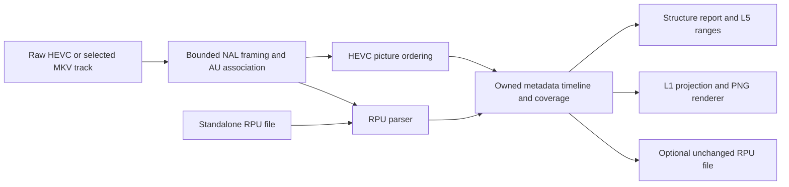

# Go Dolby Vision extraction and plotting implementation plan

Date: 12 October 2026

Target module: `github.com/Audionut/go-dovi-extract`

Status: implementation plan; no Go implementation or repository commits yet

Build a small, pure-Go library that extracts Dolby Vision RPU metadata, reports its structure, and renders L1 brightness metadata plots. Follow the library-first approach of `go-hdr10-plus`; port the required read paths from `dovi_tool`, rather than its editing, conversion, generation, or video-processing toolchain.

The first useful release must read standalone RPU files, raw Annex B HEVC, and single-track selections from MKV. It must also accept caller-supplied HEVC chunks so future disc and container integrations do not require a new RPU parser. Produce presentation-ordered metadata, an optional unmodified `RPU.bin`, a versioned analysis report, and an opaque 3000 × 1200 PNG. Runtime operation must not require Rust, libdovi, cgo, FFmpeg, dovi_tool, installed fonts, or network access.

## Requirements from the related upbrr discussion

The linked chat, [Assess HDR checks for upbrr](codex://threads/01a12e99-4d96-7e51-a296-dc0e983b2ae3), recommends Dolby Vision structure reporting and L5 active-area checks first. Its later ideas are sampled scene synchronization and two-source grade comparison. This plan incorporates the metadata needed for the first two without expanding the library into a video decoder.

A direct follow-up requirements check in that chat confirmed the first-release input scope and required a firmer full-analysis persistence contract before upbrr integration. Its additional constraints are captured below: structural completion is independent of plot availability, and completed sparse scans remain distinguishable from interrupted scans after persistence.

| Requirement | Deliverable in this library | Boundary |
| --- | --- | --- |
| RPU structure and coverage | Per-picture RPU presence; counts; coarse profile and enhancement-layer evidence; CM version inventory; level and trim-target inventory; parse diagnostics | Standalone RPU input cannot establish the number of video pictures or synchronization |
| Scene boundaries | Exact indices carrying `scene_refresh_flag == 1`, with presentation identity where available | Metadata refresh markers are not independently detected scene cuts |
| Mastering information | Present source PQ fields, L6 values, and relevant L9/L10 display information; preserve multiple values | Keep these separate from L1-derived statistics and container/MediaInfo facts |
| L5 active area | Per-picture offsets and change ranges; geometry validation when dimensions and coordinate basis are known | Black-bar detection and verification against decoded images stay outside this library |
| Trims | L2/L8 presence, counts, and target identities; retain parsed values needed for later inspection | Trim plots, saturation/hue vector plots, and artistic interpretation are deferred |
| L1 graph | Minimum, maximum, and average PQ metadata curves; nit-labelled PQ axis; exact source statistics | This is metadata visualization, not measurement of decoded picture brightness |

Keep structure, active area, synchronization, and grade as separate conclusions. A successful extraction or a flat L1 curve must not imply that a Dolby Vision grade is valid, invalid, redundant, or synchronized. Future upbrr integration owns those user-facing conclusions.

## Verified source baseline

Pin these revisions in the future provenance manifest and oracle receipts. Recheck them deliberately when upgrading the port; do not silently follow upstream main.

| Source | Inspected revision | Purpose |
| --- | --- | --- |
| [quietvoid/dovi_tool](https://github.com/quietvoid/dovi_tool/tree/614c816b6446dcd1dbaf433403d499a6026fbb5a) | `614c816b6446dcd1dbaf433403d499a6026fbb5a` | RPU read grammar, extraction format, metadata summaries, PQ formulas, plot behavior and fixtures |
| [Audionut/go-hdr10-plus](https://github.com/Audionut/go-hdr10-plus/tree/656d2051b011b88f2d0b8db9d304e779bdb4f609) | `656d2051b011b88f2d0b8db9d304e779bdb4f609` | Library shape, bounded HEVC/container parsing, presentation ordering, rendering and test patterns |
| upbrr local checkout | `422b6052422ae93270ccd9999ebf537df62d0196` | Consumer expectations in `internal/preparedrelease/hdr_subject.go`, `internal/mediafacts/mediainfo.go`, and `documentation/docs/workflow/hdr-analysis.md` |

The target repository is empty apart from Git metadata and has an unborn `main` branch. The HDR10+ checkout was clean and its HEAD matched the remote default HEAD. Its module declares Go `1.27.0`; use that same declared compatibility target for this sibling library, subject to confirming the toolchain and selected dependency versions during bootstrap.

Both reference repositories carry MIT notices. Preserve the relevant copyright and permission text for translated or adapted code and document source file/revision mappings in `THIRD_PARTY_NOTICES.md`. Do not copy GPL upbrr implementation into this library. Upstream sample assets lack a separate provenance manifest: prefer authored synthetic fixtures, and resolve redistribution provenance before committing external media samples. Preserve font attribution for whichever embedded font is selected.

### Decision-critical source anchors

1. [RPU parse and CRC sequence](https://github.com/quietvoid/dovi_tool/blob/614c816b6446dcd1dbaf433403d499a6026fbb5a/dolby_vision/src/rpu/dovi_rpu.rs#L127): framing normalization, prefix, header, mapping, DM, alignment, remaining bits, CRC, terminator.
2. [Header and profile inference](https://github.com/quietvoid/dovi_tool/blob/614c816b6446dcd1dbaf433403d499a6026fbb5a/dolby_vision/src/rpu/rpu_data_header.rs#L178): coarse profile inference does not establish profile 8.1 versus 8.4.
3. [Compressed DM handling](https://github.com/quietvoid/dovi_tool/blob/614c816b6446dcd1dbaf433403d499a6026fbb5a/dolby_vision/src/rpu/vdr_dm_data.rs#L82): compressed records omit base DM fields; upstream itself notes unresolved state for those fields.
4. [Extraction and presentation reordering](https://github.com/quietvoid/dovi_tool/blob/614c816b6446dcd1dbaf433403d499a6026fbb5a/src/dovi/general_read_write.rs#L257): no-mode extraction copies escaped bytes, strips the two-byte HEVC NAL header, sorts into presentation order, and writes four-byte start codes.
5. [L1 statistics](https://github.com/quietvoid/dovi_tool/blob/614c816b6446dcd1dbaf433403d499a6026fbb5a/src/dovi/rpu_info.rs#L319) and [PQ functions](https://github.com/quietvoid/dovi_tool/blob/614c816b6446dcd1dbaf433403d499a6026fbb5a/dolby_vision/src/utils.rs#L8): raw L1 values divide by 4095; averaging happens in PQ space before conversion to nits.
6. [Plot behavior](https://github.com/quietvoid/dovi_tool/blob/614c816b6446dcd1dbaf433403d499a6026fbb5a/src/dovi/plotter.rs): 3000 × 1200 output, PQ-coordinate L1 curves, nit labels, profile/mastering/scene captions, and additional trim modes outside this port's first release.
7. [HDR10+ NAL filtering](https://github.com/Audionut/go-hdr10-plus/blob/656d2051b011b88f2d0b8db9d304e779bdb4f609/extract/framing.go#L34): drops NAL kinds at least 41 and nonzero layers. Its public extractor therefore cannot extract DV RPU NAL type 62 unchanged.
8. [HDR10+ ordering](https://github.com/Audionut/go-hdr10-plus/blob/656d2051b011b88f2d0b8db9d304e779bdb4f609/extract/resolve.go#L115), [stream ownership](https://github.com/Audionut/go-hdr10-plus/blob/656d2051b011b88f2d0b8db9d304e779bdb4f609/extract/stream.go#L54), and [result identity](https://github.com/Audionut/go-hdr10-plus/blob/656d2051b011b88f2d0b8db9d304e779bdb4f609/extract/result.go#L18) are the relevant adaptation starting points.
9. [Renderer](https://github.com/Audionut/go-hdr10-plus/blob/656d2051b011b88f2d0b8db9d304e779bdb4f609/render.go#L12) uses Go image APIs and an embedded font. [Its extraction fixture provenance](https://github.com/Audionut/go-hdr10-plus/blob/656d2051b011b88f2d0b8db9d304e779bdb4f609/extract/testdata/PROVENANCE.md) distinguishes synthetic syntax fixtures from optional real-media differential tests.

## Scope and compatibility contract

### Required for the first useful release

- Standalone dovi_tool/x265-style `RPU.bin` input, individual escaped HEVC RPU NAL input, and individual unescaped RPU payload input through distinct APIs.
- Profiles 5, 7 MEL/FEL, and 8 as covered by the pinned parser and fixtures; CM v2.9 and CM v4.0 extensions, including mixed inventories across a stream. Metadata-only support for profile 7 does not decode or reconstruct its enhancement layer.
- Raw Annex B HEVC and native Matroska HEVC extraction, with explicit track selection or exactly one eligible HEVC candidate. Reject ambiguous selection rather than choosing the first or largest track.
- Incremental Annex B and length-prefixed HEVC input for caller-owned demuxing. Length-prefixed input requires an explicit valid NAL length size and applicable hvcC parameter sets.
- Presentation ordering, separate RPU/video/L1 counts, sparse-coverage reporting, L1 plot data, raw scene flags, L5 ranges, structure summary, and PNG rendering.
- Optional retention and writing of the original escaped RPU bytes without conversion or metadata rewriting.
- Finite resource limits, synchronous ownership, cancellation checkpoints, typed errors, offline regression fixtures, and malformed-input fuzzing.

### Deferred work

- MP4 and TS/M2TS file adapters; Blu-ray playlist composition and the upbrr integration itself. These are follow-on deliverables, not silently claimed first-release support. The packet interface must support future producer timing and discontinuity facts, but a generic chunk collector alone does not prove playlist correctness.
- Separate BL/EL track or PID pairing, arbitrary multilayer HEVC, encrypted input, disc decryption, ISO/SSIF handling, AV1/T.35 RPU transport, and other codecs.
- Profile conversion; RPU editing, injection, generation, crop rewriting; XML; mux/demux of video; residual/NLQ application; tone mapping; image decoding.
- dovi_tool's full JSON object schema and full CLI compatibility. Provide a stable Go-oriented analysis schema instead.
- L2/L8/vector rendering, contact sheets, sampled scene-sync scoring, black-bar detection, and two-source brightness/grade comparison.
- A production CLI, configuration framework, web UI, plugin system, generic cross-repository HEVC framework, and concurrent worker pools. Tests/examples provide the initial executable usage surface.

Unsupported grammar must produce an explicit unsupported error. Do not approximate an unfamiliar RPU profile or silently skip bytes until an apparent L1 block is found. Preserve successfully parsed sparse coverage as evidence; malformed or truncated input is a failed analysis.

## Architecture and package boundaries

Use two public packages and internal parser helpers. Do not expose Rust-shaped mapping trees or a generic binary codec framework.



| Proposed files | Responsibility |
| --- | --- |
| `go.mod`, `LICENSE`, `THIRD_PARTY_NOTICES.md` | Module baseline, pinned dependencies, attribution |
| `rpu.go`, `metadata.go`, `summary.go`, `errors.go` | Root package `dovi`: public parsed fields, analysis model, validation and summary contracts |
| `internal/rpu/{bits,header,mapping,nlq,dm,blocks,crc}.go` | Bounded read-only syntax implementation and diagnostics |
| `pq.go`, `plot.go`, `render.go` | Numeric projection, render options, opaque deterministic image production |
| `extract/{extract,rpufile,stream,framing,hevc,resolve,matroska,result,limits,errors}.go` | Input adapters, ordering, extraction model and caller ownership |
| `*_test.go`, `testdata`, `extract/testdata` | Numeric, binary, frame-order and image fixtures with provenance |
| `README.md`, `examples` | Supported-input matrix and library examples |

File names are responsibility boundaries, not a requirement to split every small helper into a separate file. Keep helpers private unless an actual caller needs them.

The planned direct dependencies are `golang.org/x/image` for text/vector drawing and `github.com/at-wat/ebml-go` if its bounded block/lacing reader is retained from the reference. Verify versions against Go 1.27.0 before pinning. Standard-library image/PNG/math/IO facilities handle the rest. Do not add `go-mp4`, `go-astits`, a Rust binding, or a plotting framework to the first release.

The HDR10+ framing, picture resolver, and container readers are internal and coupled to HDR10+ payloads. Adapt the minimum relevant source with attribution into this repository; do not import `go-hdr10-plus/extract` and expect RPU events, and do not make a shared-library refactor a prerequisite. Record adapted paths and tests so fixes can be compared later. Replace both the scanner's type-62 filtering and the resolver's HDR10+-specific payload/coverage assumptions.

## Public API and data contracts

The following names describe the intended API, to be finalized with compiling examples in milestone 1. The ownership and error semantics are requirements even if names change.

| API | Contract |
| --- | --- |
| `dovi.ParseRPU(rbsp []byte, opts ParseOptions) (RPU, error)` | One unescaped payload beginning with `0x19`, including CRC and terminator; no start code or HEVC NAL header; does not retain caller bytes |
| `dovi.ParseNAL(nal []byte, opts ParseOptions) (RPU, error)` | One escaped type-62 HEVC NAL including its two-byte header; no start code or length prefix; validates header and unescapes exactly once |
| `extract.ReadRPU(ctx, reader, opts) (*Extraction, error)` | Bounded standalone RPU stream; preserves stored order and records that picture coverage and PTS are unknown |
| `extract.Extract(ctx, readSeeker, opts) (*Extraction, error)` | Native raw HEVC/MKV path; explicit format or signature-based detection; caller owns the reader |
| `extract.NewStream(ctx, opts)`, `Push(Chunk)`, `Finish()`, `Abort(error)` | Synchronous single-owner HEVC collector; data/marker slices borrowed only for `Push`; normal EOF is distinct from producer failure |
| `Extraction.Analysis(AnalysisOptions) (*dovi.Analysis, error)` | Validated owned copy for reporting/rendering, independent of extractor mutation; separate finite operation budget |
| `extract.WriteRPU(writer, extraction) error` | Requires retained original bytes and an eligible complete timeline; writes four-byte-delimited escaped payloads in established order |
| `dovi.Summarize(analysis, SummaryOptions) (Summary, error)` | Validates caller-visible fields and computes structure, L1 statistics and L5 ranges within a separate finite operation budget |
| `dovi.Render(ctx, analysis, PlotOptions) (image.Image, error)` | New opaque 3000 × 1200 image; caller performs PNG encoding and owns destination handling |

Do not autodetect the meaning of an arbitrary byte slice by repeatedly trying escape removal. Distinct public payload/NAL/file entry points avoid double unescaping. File autodetection must distinguish `00 00 00 01 19...` RPU framing from ordinary HEVC; an explicit format overrides detection, and conflicting signatures fail.

### Timeline and ownership

- Extraction retains compact parsed RPU records and presentation-picture references. Each picture records dense presentation index, AU/decode ordinal, POC when known, rational PTS when known, selected stream identity, and optional RPU index. Unknown values have presence flags or optional fields; zero is a valid PTS/index/value.
- For video input, the completed retained RPU table contains only records referenced by output pictures. Parse and validate RPUs associated with suppressed pictures, count them separately as observed/suppressed source records, then discard them from the completed table. An RPU without an unambiguous access-unit/picture association is an orphan and fails extraction, even if the surrounding stream might otherwise suppress output. Duplicate RPUs for any one picture also fail. Standalone RPU input retains every record because it has no picture-output evidence.
- Profile/CM/level inventories, scene markers, L5 ranges and L1 statistics use only output-picture references for video input, or all stored sequence records for standalone input. They never include suppressed records. `WriteRPU` traverses output pictures and their referenced raw records in presentation order, not the raw record table or source-observation order.
- Standalone RPU input has a separate sequence index and timeline kind `rpu_sequence`. Do not synthesize video picture records or a video-frame denominator from the RPU count. Render its x axis as RPU index. Video extraction uses `presentation_frames` and includes pictures with no RPU.
- `KeepRaw` is opt-in and retains the original escaped payload excluding HEVC header/start code, charged to the same memory budget. Parsing and plotting do not require retaining raw payloads for the entire movie. No full VCL bodies are retained.
- Result values are owned and caller-mutable; concurrent mutation is unsupported. Summary/projection/render entry points validate inputs. The extracted analysis copy must not alias internal reusable buffers.
- The stream is single-use. After an error or abort, it stays failed; after `Finish`, further pushes fail. A producer error must use `Abort`, never convert truncated input into a normal finish. No goroutines are required.
- On parse, order, IO, quota, or cancellation failure, return no completed analysis. Progress callbacks, if added, are provisional and cannot be used as certified absence or completed results.
- A successfully scanned video with zero RPUs returns a complete structural result with `coverage=absent`, not a malformed-stream error. Empty/truncated raw input fails. Rendering an analysis without any valid L1 samples returns `ErrNoL1`.

### Coverage and serialization

Use `complete`, `partial`, `absent`, and `unknown` coverage states. Store separate counts for output pictures, pictures containing exactly one RPU, retained RPU records, L1-present samples, and missing-RPU pictures. Also expose explicitly labelled observed-source and suppressed-picture RPU counts; neither is the coverage numerator or the plot sample count. A standalone file uses `unknown` video coverage even when every parsed RPU has L1. A video stream producing no output pictures is an unsupported/empty analysis, not certified RPU absence. Frame-count equality alone never proves synchronization.

Version the external analysis report with `schema_version: 1`. Include timeline kind, complete-scan status, source track identity when known, coverage/counts, metadata profiles and their evidence, CM/level inventories, raw scene markers, mastering values, L5 ranges, L1 statistics, and structured warnings. Do not serialize private paths, opaque application authorities, NaN/Inf, or inferred compatibility as verified facts. Sort set-like fields for stable JSON.

Before upbrr integration, require a documented, versioned full-analysis round-trip representation in addition to the summary report. It must preserve picture/RPU associations, missing intervals, timeline kind, exact rational timing/presence, complete-scan status, coverage, scene flags, L5 fields/ranges, parsed metadata and all evidence/unknown markers needed to reproduce reports and plots. Raw RPU bytes are optional and required only to restore raw export capability. A consumer-owned sidecar and serializer are sufficient; library serialization helpers are not required for the first release. Document the necessary data contract in milestone 5 and require round-trip equivalence tests in the integration milestone. Restore through bounded decoding and the same structural validation used for caller-owned analysis; reject unknown schema versions, inconsistent references, forged derived counts and excessive input sizes before rendering. Restored derived fields must be checked or recomputed from the retained frame/metadata facts.

Structural success does not require L1 or a positive scene-marker count. A valid completed report may have no plot (`ErrNoL1`) or zero encoded refresh flags. Likewise, a completed scan with partial RPU coverage is a complete structural analysis with gaps; an interrupted scan is never a completed result. Persistence and the eventual DV consumer must preserve those distinctions instead of satisfying HDR10+-specific validators with fabricated data.

Errors should support `errors.Is`/`errors.As`: invalid bitstream, unsupported syntax/input, incomplete input, ambiguous track, resource limit, no L1, and invalid caller metadata. Wrap underlying IO/context errors; attach input offset, decode/presentation index, level/field and known flags when available. Unknown metadata presence is not a parse error by itself, but unsupported extension grammar is.

## RPU parser implementation

### Framing, CRC and bounded reads

1. Implement an MSB-first bit reader with fixed-width reads, unsigned/signed Exp-Golomb where required, bounded skip, byte alignment and explicit remaining-bit accounting. Check every length, count, shift, multiplication, and allocation before use. Do not allocate from untrusted Exp-Golomb counts without limits.
2. The standalone record envelope is `00 00 00 01` followed by escaped RPU bytes beginning `0x19`; the HEVC header `7c 01` is absent. Accept three-byte Annex B delimiters on input where unambiguous, and canonicalize output delimiters to four bytes. Handle delimiters split across reads and distinguish framing zero padding from syntax bytes.
3. Remove emulation-prevention bytes once using validated escape rules. Check the `0x19` prefix, final `0x80` terminator and permitted trailing zero behavior. Preserve original escaped payload bytes separately when requested.
4. Implement **CRC-32/MPEG-2**, not Go's ordinary reflected IEEE checksum: polynomial `0x04C11DB7`, initial value `0xffffffff`, non-reflected processing and zero final XOR. Validate against the unescaped payload after the prefix and before the stored CRC. Confirm endian handling and the `123456789` check vector `0x0376e6e7` against the pinned reference before relying on it.
5. Reserve the CRC/terminator boundary before parsing variable-length data. Validate zero alignment bits. Preserve/report bounded remaining bytes before CRC without interpreting them as extension metadata; these are present in upstream fixtures.

### Mandatory syntax closure

L1 is not at a fixed byte offset. Correct extraction needs the variable-length syntax preceding it:

- RPU header flags, format/profile/level, bit depths, coefficient encoding and denominator, residual/spatial flags, metadata-present flag, reuse flag and previous ID.
- Mapping IDs, component pivot counts/values, partitions, polynomial/MMR coefficient grammar, and NLQ syntax needed to advance correctly and classify MEL/FEL when evidence is present.
- Base DM IDs, scene refresh flag, matrix/signal fields and source minimum/maximum PQ, followed by CM extension containers.

Read and validate mapping/residual coefficients but discard values not needed by reporting; do not implement polynomial evaluation or residual reconstruction. Bounds and validation remain necessary even for discarded fields. The pinned upstream leaves polynomial interpolation unimplemented (`rpu_data_mapping.rs`, around lines 413–415): detect it and return unsupported instead of reproducing a panic or inventing a parser.

`use_prev_vdr_rpu_flag` skips mapping data only. It does not mean copy the previous frame's DM or L1. Parse current DM independently. For the initial implementation, report a reused mapping's MEL/FEL classification as unknown unless a separately tested ID-based resolution proves it; keep the reuse flag/ID as evidence. Do not carry forward L1/L5 simply because they are absent.

Compressed DM may contain current IDs, scene flags and extension blocks while omitting base DM fields. Parse present extensions, but mark omitted source/signal/mastering fields unknown rather than accepting upstream default zeros as facts. Effective-state reconstruction is deferred until there are authoritative state-transition fixtures. Unknown base fields must not prevent plotting valid explicitly present L1.

### Extension metadata

Use the pinned CM container grammar and validate allowed levels, block lengths, count/cardinality, field ranges and padding. Known containers are CM2.9 levels `1,2,4,5,6,255` and CM4.0 levels `3,8,9,10,11,253,254`. CM4.0 data can accompany the CM2.9 container; do not model the two inventories as mutually exclusive.

| Levels | Retained public information |
| --- | --- |
| L1 | Raw 12-bit minimum, maximum and average PQ values; explicit presence |
| L2 and L8 | Target identity and trim fields, including optional L8 fields according to block length; multiple targets per RPU |
| L5 | Left/right/top/bottom active-area offsets and presence |
| L6 | Mastering luminance and content-light fields with original units |
| L9 and L10 | Display/primary or target-display identity and applicable custom values |
| L11 and L254 | Content/version information needed by the structure report |
| L3, L4, L253, L255 | Validate their known layout and record occurrence; avoid large public object trees until a consumer needs their values |

Unknown extension levels fail with `ErrUnsupported` in the first release, matching the conservative upstream read boundary. Do not mistake a length-delimited unknown block for fully validated supported metadata. Preserve raw source bytes for a future parser upgrade when requested.

The pinned L1 reader accepts every value in `0..4095` independently for each field. Preserve those values exactly. Do not import the generator's CM-dependent clamping or require `min <= average <= max` as a parser invariant. Any suspicious relationship is a separately labelled report observation, not permission to modify metadata or reject an otherwise accepted RPU. Add fixtures proving preservation at endpoints and for unusual relative values.

Report coarse profiles 5/7/8 as inferred from supported RPU header evidence. Keep external container/MediaInfo profile and base-layer compatibility facts in distinct optional fields. Do not automatically label profile 8 as 8.1, 8.2, or 8.4; do not infer the existence or validity of an enhancement video stream from RPU metadata alone. Unsupported profile 4/unknown forms fail explicitly.

## HEVC extraction and presentation order

Adapt the reference's tested HEVC read subset: parameter sets, slice headers, access-unit boundaries, POC/reference and output ordering, hvcC handling, and bounded syntax-prefix retention. Replace HDR10+ SEI collection with type-62 RPU collection while keeping parameter/slice validation. RPU NALs need their own bounded body retention; ordinary VCL payloads remain skipped after the necessary syntax prefix.

Associate each RPU with its actual access unit before reordering, including multi-slice pictures, permitted suffix placement and EOF flush. Do not assign a video frame number by counting RPUs. Track missing RPUs as missing picture data rather than compacting them away. Multiple RPUs for one output picture are ambiguous and fail initially; do not inherit upstream's duplicate-discard behavior without a separately specified policy.

Resolve output pictures using the reference's POC/reference rules and sequence boundaries. Cover B-frame reorder, POC wrap, IRAP/reset, open-GOP boundaries and suppressed output. Do not globally sort all POCs or all timestamps: POC resets and timestamp discontinuities make that unsafe. Timestamp values remain exact rationals; PTS is corroborating timing evidence, not a replacement for picture identity.

For the first release, support the ordinary selected-track stream with base-layer picture syntax and associated type-62 RPU NALs, including profile-7 metadata when that association is unambiguous. Ignore enhancement picture bodies only after validating their transport/header envelope; never count them as additional base output pictures. Separate-track BL/EL pairing and unproven layer associations return unsupported. Capture supported layer/temporal combinations in fixtures before advertising them.

The packet API follows the proven shape: contiguous elementary-stream offsets, borrowed byte chunks, framing/length-size/codec configuration, and explicit sample/timing/discontinuity markers. Reject contradictory offsets or markers and unsupported discontinuities instead of continuing a fabricated timeline. Adopt only marker fields actually needed by the initial HEVC/MKV path; add transport-specific packet/PES authority fields when implementing that adapter.

### Matroska adapter

Adapt the bounded synchronous MKV traversal and block/lacing handling from `go-hdr10-plus/extract/matroska.go`. Resolve the selected HEVC track and codec configuration before collection. Cover SimpleBlock and BlockGroup, timestamps/scales, supported lacing, invisible samples, unknown-sized elements, and truncation at every envelope boundary. Track IDs are actual Matroska TrackNumbers, not positional indices. Reject encrypted/compressed track encodings or unresolved multi-video selection. Keep source dimensions and their coordinate basis separate from display aspect-ratio metadata.

### Writing the extracted RPU file

`KeepRaw` plus `WriteRPU` produces unchanged RPU payload bytes in established presentation order. No RPU field writer, CRC recalculation, editing, or conversion is needed. Normalize only the transport envelope by stripping the HEVC NAL header and writing four-byte delimiters. Define and test trailing framing-zero treatment independently of payload bytes.

For video input, permit standalone `RPU.bin` output only when every output picture has exactly one supported RPU and ordering is established. A sparse stream can still yield an analysis and plot with gaps, but a compacted RPU file would hide those gaps and is refused. A valid standalone RPU sequence can be re-emitted in its stored order without asserting video coverage.

Validate the result and raw-retention prerequisites before writing. A destination IO failure can leave partial bytes; callers own temporary files and publication/rename. Library functions neither overwrite source paths nor manage application output directories. Examples must encode into a new temporary destination, close successfully, and publish only after all steps succeed.

## Structure report and L5 checks

Keep all distinct profiles, CM container/version evidence, mastering values, trim targets and level inventories. For repeated values, report counts/ranges rather than assuming the first record describes the whole video. Expose source PQ values, L6 luminance/content-light fields and L1 statistics separately.

Scene marker count is the count of actual refresh flags. A consumer may divide a timeline into segments beginning at index zero, but must label an inserted initial segment boundary separately from an encoded scene marker. Missing metadata breaks inferred ranges; no carry-forward across gaps.

L5 range records use zero-based inclusive start/end indices and explicit coordinate kind. Coalesce only adjacent identical valid offsets; preserve missing intervals and changes. For known applicable raster dimensions `W,H`, use checked arithmetic and require `left+right < W` and `top+bottom < H`, with positive dimensions and individually valid offsets. Return computed active width/height and the evidence for the dimensions. Geometry failures are report findings, distinct from binary parser errors.

When SPS conformance windows, cropped encodes, container display dimensions or caller-supplied dimensions disagree, retain the evidence and mark L5 applicability unresolved until the coordinate mapping is established. Never use display aspect ratio or guessed 3840×2160 dimensions as the raster. The first release does not sample pixels and therefore reports no black-bar match verdict.

## L1 numerical and rendering contract

Use float64 for conversions and aggregation. Preserve raw integers in public metadata. For raw L1 code `v`, normalized PQ is `p = v / 4095.0`.

The ST 2084 conversion uses `m1=2610/16384`, `m2=2523/32`, `c1=3424/4096`, `c2=2413/128`, `c3=2392/128`:

```text
q = p^(1/m2)
nits(p) = 10000 * (max(q-c1, 0) / (c2-c3*q))^(1/m1)
```

Restrict the public conversion input to its documented finite domain. The all-zero input maps to zero; code 4095 maps to 10000 nits. Test endpoints, representative intermediate values and inverse round trips against an independent numeric oracle.

- Plot min/max/average L1 curves in normalized PQ coordinates, with nit-labelled ticks. A linear-nit axis or ordinary logarithmic axis would change dovi_tool's visual interpretation.
- Maximum L1 peak is `nits(max(max_pq)/4095)`. Maximum L1 average is `nits(max(avg_pq)/4095)`. Upstream-style mean peak/average values are `nits(mean(code)/4095)`, not `mean(nits(code/4095))`. Name them explicitly as PQ-domain means in the report.
- Labels must distinguish L1-derived peak/average from L6 MaxCLL/MaxFALL and pixel measurements. Do not copy upstream's potentially ambiguous MaxCLL/MaxFALL legend wording into the report.
- Upstream substitutes default metadata when L1 is missing. Deliberately differ: retain a gap, exclude missing samples from statistics, and show valid-sample count and coverage. Do not carry forward or fabricate zero/black metadata. Complete-L1 inputs are the numeric parity target.
- Default output is opaque white, 3000 × 1200, with blue maximum, purple average and dark minimum curves, embedded font, legend and readable captions. Reuse the HDR10+ drawing approach, not its 0.1-nit input schema or estimator choices.
- Render all samples into bounded per-pixel-column envelopes when downsampling is required; retain extrema so a narrow high-peak event survives. Calculate all summary statistics from original samples. Mark any missing-data bucket as discontinuous rather than bridging a gap.
- Crops use optional zero-based inclusive endpoints, with an omitted end distinct from explicit zero. Reject invalid ranges. Preserve original timeline indices on the x axis and compute visibly labelled crop-specific statistics. This differs from upstream's re-zeroed cropped axis.
- Handle one-sample and constant-zero series without division by zero or degenerate axes. Use a documented positive axis floor (proposed 100-nit PQ coordinate) when needed; the floor affects only rendering, never statistics. Filter ticks to the visible range.
- Captions show timeline kind, plotted/total samples, coverage, profile evidence, CM inventory, scene markers and relevant L5/mastering/trim summaries. Bound long titles and unique-value captions; show a concise count and keep full information in the report.

Require semantic and numeric parity, not pixel-identical reproduction of Rust plotters. Deterministic Go-rendered pixel goldens establish this project's own stable rendering contract.

## Limits, cancellation and failure handling

Start with the reference's limits where relevant, then measure representative small inputs. Every zero-value option selects finite defaults; there is no implicit unlimited mode.

| Resource | Proposed initial default |
| --- | --- |
| Output pictures or standalone RPU records | 2,000,000 |
| Total extractor-owned retained allocations, including optional raw bytes | 512 MiB |
| Container/index allocations, included within the total | 128 MiB |
| Single MKV block | 64 MiB |
| Retained parameter/slice syntax prefix | 64 KiB per relevant unit |
| Single escaped RPU payload and working decoded buffer | 1 MiB each, both charged while live |
| Pending reordered pictures | 64, also constrained by supported stream syntax |
| Container nesting | 32 |
| Extension blocks in one RPU | 256, further constrained by available bits and supported block rules |

These extraction quotas are per operation, not promises about process RSS. Charge capacities and temporary copies, not just logical lengths; extractor sub-budgets count toward its total. Limits may be raised explicitly, but bounds/overflow checks cannot be disabled.

`AnalysisOptions` and `SummaryOptions` each select a separate finite operation budget, with zero-value defaults of 2,000,000 records and 512 MiB of new owned/temporary allocations. They do not share or consume an extraction's accounting object. Preflight the actual current caller-visible counts, nested lengths and checked size totals before copying or constructing collections, and reject caller-expanded metadata exceeding the accepted input limits. Charge the analysis copy, summary sets, scene/L5 ranges, map capacities and temporary work to their respective operation budget. Original caller-owned input memory is excluded: retaining both an extraction and its independent analysis copy can exceed 512 MiB in aggregate, which must be documented. Repeated calls return independent results rather than promising a process-wide cap.

`PlotOptions` similarly bounds accepted input counts/structure and gives rendering a proposed 32 MiB owned-allocation budget for the fixed canvas, font resources, summaries and width-sized envelopes. Rendering must not construct an unbounded full-report summary just to draw captions; derive only the bounded caption/statistic projection it uses. Any internal summary allocation is charged to the render budget. On return the image becomes caller-owned; caller PNG buffers and multiple retained images are outside the renderer's per-call accounting. Validate long titles/labels before font/glyph allocation. A more generous explicit budget is allowed when measured requirements justify it.

Check context between reads, NALs, bounded parsing loops, ordering work and rendering rows/columns. Context cancellation cannot interrupt an arbitrary caller-owned blocking `Read` or `Write`; document that callers must supply deadline-aware IO or close their own resources if they require that. Avoid per-byte context checks and unnecessary goroutines. Errors include the offending resource and configured limit.

## Implementation milestones and acceptance gates

### Milestone 1 — Baseline, fixture authority and API examples

Create module, notices, provenance records and the small public models. Confirm the Go 1.27.0 baseline and dependencies. Draft design-level examples for standalone RPU parsing, MKV extraction, summary generation and PNG output, explicitly specifying failure/ownership semantics. Compile and execute each example in the milestone that implements its APIs; do not add nonfunctional exported stubs just to make milestone 1 examples compile. Establish an oracle harness for the pinned Rust revision in a separate development directory; it is never a runtime dependency.

Acceptance: supported/deferred format matrix and raw/presentation timeline distinction are explicit; fixture origin, SHA256, upstream revision and exact oracle commands are recorded. Do not claim parser support from sample filenames alone.

### Milestone 2 — RPU read subset

Implement bounded bit reading, CRC, framing normalization, header, mapping/NLQ traversal, DM and extension blocks. Add profile and unknown-field evidence to the compact model. Implement streaming standalone RPU reading and optional raw retention.

Acceptance: exact field parity on P5, P7 MEL/FEL, P8 and CM4 fixtures; present L1 in compressed DM works without fabricated mastering values; mapping reuse does not copy previous DM; unknown/unsupported syntax fails explicitly; CRC/truncation tests fail at the correct boundary. No writers for edited RPUs are introduced.

### Milestone 3 — HEVC collection and ordering

Adapt framing/syntax/resolution from the HDR10+ source, replacing NAL filters and payload rules. Implement chunk ownership and Finish/Abort semantics, actual AU association, missing-RPU picture records, and raw Annex B extraction. Establish layer support with fixtures.

Acceptance: decode order `[0,1,2]` versus display order `[0,2,1]` produces matching RPU association; missing first/middle/last metadata does not shift indices; duplicates fail; IRAP/POC wrap and open-GOP fixtures pass; arbitrarily split pushes equal contiguous input; cancellation and quotas do not yield a complete result. Standard no-gap output matches pinned dovi_tool extraction bytes after the explicitly documented envelope normalization.

### Milestone 4 — Native MKV extraction and unchanged RPU output

Adapt track discovery and bounded block parsing. Feed the same collector from selected-track MKV samples. Implement format detection, explicit TrackNumber selection, hvcC handling and `WriteRPU` validation.

Acceptance: MKV and its equivalent elementary stream yield the same presentation timeline and parsed fields; ambiguous tracks and unsupported encodings fail; lacing, timing, invisible pictures and truncated blocks are covered; sparse coverage remains reportable but cannot be silently compacted into RPU output. Raw retention/write errors are distinguishable from parse errors.

### Milestone 5 — Structure summary, L5 and L1 plots

Implement summary/report schema, scene marker and L5 range derivation, PQ/statistic functions, validated projection, renderer and examples. Add explicit missing-value and crop handling. Document the full-analysis persistence fields and restore-validation contract required by later consumer integration, without adding serialization infrastructure unless an actual consumer needs it.

Acceptance: numeric parity for complete L1 fixtures; tested gap behavior; L5 coordinate unknown/invalid/valid outcomes; mixed-profile/CM/mastering inventories; valid opaque 3000 × 1200 PNGs with no installed fonts; narrow extrema survive downsampling; one-frame/zero/crop cases render correctly. Inspect rendered outputs visually in addition to pixel tests.

### Milestone 6 — Hardening and release readiness

Complete fuzz seeds, differential fixtures, offline tests, small representative benchmarks, platform checks and public support documentation. Review the complete material implementation and then review the final corrected state independently under the applicable repository workflow. Keep receipts tied to the exact state.

Acceptance: all first-release gates pass, no known silent misassociation or fabricated metadata values, bounded memory behavior is measured, and the public API examples run with cgo disabled. Publish or commit only when separately instructed.

Milestones 2 and 3 are the largest correctness risks. Do not accept a demo plot as evidence that the HEVC ordering and RPU grammar gates are complete. Milestones 1–6 define the first useful release; deferred container/consumer work is separate.

## Verification matrix

| Area | Required evidence |
| --- | --- |
| Binary parser | Header/mapping/NLQ variations; integer/float coefficient forms supported by upstream; CM2.9/4.0; all known level layouts and length variants; empty containers; unknown levels; reuse; compressed DM; data before CRC; trailing zeros |
| Integrity | MPEG-2 CRC check vector plus bit-flip tests; invalid prefix/terminator; illegal escapes/alignment; truncation at each field/length boundary; huge Exp-Golomb counts and arithmetic overflow |
| Extraction | No RPU; partial coverage; duplicate/orphan RPUs; multiple slices; prefix/suffix placement; selected track; codec configuration; B frames; POC wrap/reset; output suppression and exclusion from inventories/written output; unsupported layers/discontinuities |
| Streaming | Every split position in small inputs; split start codes/length prefixes/escapes; input mutation after Push; IO error versus EOF; calls after failure/finish; context cancellation; separate collectors do not share mutable state |
| Report | No guessed profile 8 subprofile; unknown compressed fields; exact CM container counts; source versus L6 versus L1 values; actual scene flags; L5 change/gap ranges and checked geometry |
| Numerics | PQ endpoints/round trips; distinct PQ-mean versus nit-mean fixture; extrema and valid-count denominators; no NaN/Inf; crop-specific stats |
| Images | Decoded RGBA pixel goldens; opaque dimensions; gap preservation; long title/caption bounds; no fonts installed; one point/constant series; spike envelope; visual inspection |
| Resource handling | Every independent quota boundary; raw-retention accounting; bounded VCL retention; independent analysis/summary allocations; caller-expanded models; render allocations; read/write errors; no unowned reader close; no panic/hang in fuzzing |

Useful upstream candidates include tiny `profile5.bin`, `profile8.bin`, `mel_orig.bin`, `fel_orig.bin`, `profile84.bin`, `cmv40_full_rpu.bin`, `empty_dmv1_blocks.bin`, and the data-before-CRC fixture, subject to checking their exact paths and provenance. The upstream raw HEVC, extracted-RPU and MKV examples are small enough for differential work; do not start with a feature-length remux. Author minimal unsupported/malformed inputs locally rather than storing private media in Git.

Build the reference executable from the pinned revision with its internal-font feature when needed. The inspected versions are dovi_tool 2.3.4 and dolby_vision 3.4.0; the root Cargo manifest requires Rust 1.95.0, while its README still advertises an older minimum. Follow the pinned manifest. Record the build command, Cargo.lock, binary hash and version. Oracle invocations include `extract-rpu -i <small.hevc> -o <RPU.bin>`, `info -i <RPU.bin> -s`, `info -i <RPU.bin> -f <zero-based-index>`, and `export -i <RPU.bin> -d all=<json>`. First verify exact flags with that binary's help. Compare exact integers/order/bytes, and float64 results with explicit absolute/relative tolerances (initial target `max(1e-9, abs(expected)*1e-10)` for nits, adjusted only with recorded numeric evidence). Goldens record upstream defaults; deliberate gap/label/crop differences have independent contract tests.

The Go extractor deliberately validates supported RPU syntax and CRC. Upstream's default no-mode extraction instead copies RPU bytes without parsing or CRC verification. Restrict byte-parity comparisons to independently parser-validated inputs; a successful upstream raw extraction is not proof of metadata validity. Corrupt-CRC inputs must fail Go extraction even if upstream can copy them.

The pinned extractor itself has simplifying assumptions around missing/duplicate RPU association. Use authored picture/RPU identity fixtures as the authority for those adversarial cases; matching upstream output is insufficient proof there.

Planned parent-owned validation commands after implementation:

```powershell
go mod verify
gofmt -l .
go vet ./...
go test ./...
go test -race ./...

$previousCGO = $env:CGO_ENABLED
try {
    $env:CGO_ENABLED = '0'
    go test ./...
} finally {
    $env:CGO_ENABLED = $previousCGO
}

go test -run '^$' -bench . -benchmem ./...
```

`gofmt -l .` must return no files. Run race testing separately with the supported race toolchain, not under the cgo-disabled environment. Add bounded dedicated fuzz jobs for RPU, NAL framing, HEVC syntax/order, MKV and numeric/report validation. Execute native CI tests on Windows and Linux, with macOS portability coverage where available. Record every command, result, relevant source/fixture fingerprint and log path; rerun affected checks after corrections. Private real-service/media verification is optional and separate from offline correctness gates.

Benchmark isolated RPU parsing, raw HEVC/MKV extraction, summary building and plotting. Use small representative sources or repeated authored streams to measure throughput/allocations and growth. Establish a baseline before setting performance targets. Use large remux sources only if smaller cases cannot exercise a resource limit or a specific boundary.

## Follow-on upbrr and disc integration

The existing upbrr HDR workflow is HDR10+-specific: current eligibility and retained metadata formats cannot be relabelled as Dolby Vision support. A later change must add distinct DV eligibility, result types and parser/render schema identity while preserving source binding and retry behavior.

1. Integrate native MKV analysis on the exact prepared source/selected HEVC track. Keep container and MediaInfo evidence separate from parsed RPU evidence. Require the full-analysis persistence contract above and validate a write/read round trip that reproduces reports and plots, including gaps, exact timestamps, absent L1 and zero scene flags. Retain completed analysis before rendering so render failures and changed plot options can reuse it without rescanning. Introduce DV result validation that permits a successful structural report without a plot or positive scene-marker count; do not reuse HDR10+-specific success assumptions.
2. Add consumer cache keys covering source fingerprint, exact stream selection, extraction schema, parser version, plot range/options and rendering version. Upbrr owns private paths, authorization, image hosting, description insertion and artifact lifetime.
3. Extend the disc producer only after proving the selected playlist's clip occurrences, in/out ranges, presentation timing, repeats and discontinuities. Feed selected HEVC bytes into the DV collector; do not assume scanning the largest `.m2ts` or parsing RPUs alone yields playlist coverage.
4. Keep the disc bridge in an optional integration module initially. The HDR10+ reference's `integration/bdinfo/go.mod` currently uses development-only local replacements; it is not a ready immutable dependency contract. Pin supported released dependencies before shipping such a bridge.
5. Add scene-sync contact sheets or black-bar sampling in a separate decoded-video pipeline, consuming the library's timestamp/scene/L5 evidence. Two-source grade analysis remains a separate feature with its own measurement rules.

No edits to upbrr, go-hdr10-plus or go-bdinfo are part of executing this plan's first-release milestones.

## Decisions to confirm during implementation

These are targeted engineering gates, not reasons to delay the initial parser work:

- Confirm the exact supported layer/temporal combinations, random-access boundaries and hvcC variants against small P5/P7/P8 streams before advertising native video extraction support.
- Verify fixture provenance and produce redistributable synthetic replacements where needed. Record exact file paths/hashes rather than relying on descriptive names above.
- Verify the relevant SPS/container/L5 coordinate relationship before emitting a geometry verdict for cropped/conformance-window streams. Unknown remains a valid report result.
- Resolve any input grammar beyond the pinned read subset with explicit fixtures/specification evidence. Do not implement speculative metadata inheritance or profile 8 compatibility inference.
- Confirm dependency/toolchain availability and tune proposed resource limits from measured allocations. The selected Go baseline follows the sibling module's declared target, not merely the installed compiler.

## Planning validation receipt

Repository/source inspection and linked-chat review informed this plan. Source code was not implemented, compiled, tested, benchmarked or modified in the reference repositories. Numeric, binary, resource and rendering checks above are future acceptance gates, not reported successes. No commits, branches or pushes were made for this plan.

Initial independent Go specification review: approved with questions, with no blocking findings. Its questions about suppressed-picture records and per-operation copy/summary budgets were resolved in this plan. Advisory corrections clarified milestone sequencing, L1 preservation, the Rust oracle baseline, and strict Go CRC validation. A fresh final review and document-check receipt are saved separately alongside this plan.
